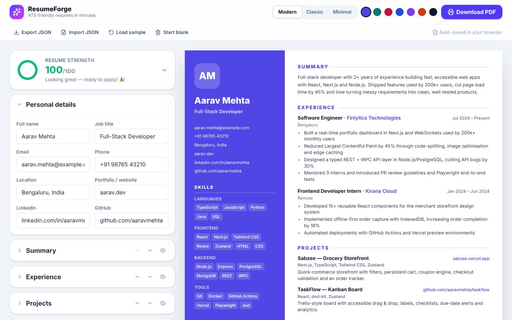

# ✨ ResumeForge — ATS-friendly resume builder

**Live demo:** [resumeforge-jeevan.vercel.app](https://resumeforge-jeevan.vercel.app)




Build a clean, recruiter-ready resume with a live A4 preview, switch between three templates, check your resume strength and export a real text-based PDF (not an image) that applicant-tracking systems can parse.

**Tech:** React 19 · TypeScript · Vite · Tailwind CSS v4 · Zustand (persisted) · Lucide icons

## Features

- **Live A4 preview** that scales responsively with a `ResizeObserver`
- **3 templates** — *Modern* (two-column with accent sidebar), *Classic* (serif, centred) and *Minimal* — plus 7 accent colours
- **Structured editor** for personal details, summary, experience, projects, education, skills and certifications
- **Reorder & hide sections**, reorder entries inside each section
- **Resume strength score** — 10 weighted checks (action verbs, quantified impact, summary length, contact info, skills count…) with actionable tips
- **Download PDF** via print-optimised CSS (`@page A4`, exact colours, unscaled print copy)
- **JSON export / import** to back up or move your resume, sample data loader and "start blank"
- **Autosave** to `localStorage`; mobile-friendly Edit / Preview tabs

## Getting started

```bash
npm install
npm run dev       # http://localhost:5173
npm run build     # type-check + production build
npm run lint      # oxlint
```

## Structure

```
src/
├── store.ts               # Zustand store with generic list CRUD + section ordering
├── lib/
│   ├── types.ts           # Resume schema
│   ├── sample.ts          # Sample resume, defaults, accent palette
│   └── score.ts           # Resume strength analyser
└── components/
    ├── Editor.tsx         # Config-driven form panels
    ├── Preview.tsx        # Template renderers
    └── ScoreCard.tsx      # Score ring + suggestions
```
